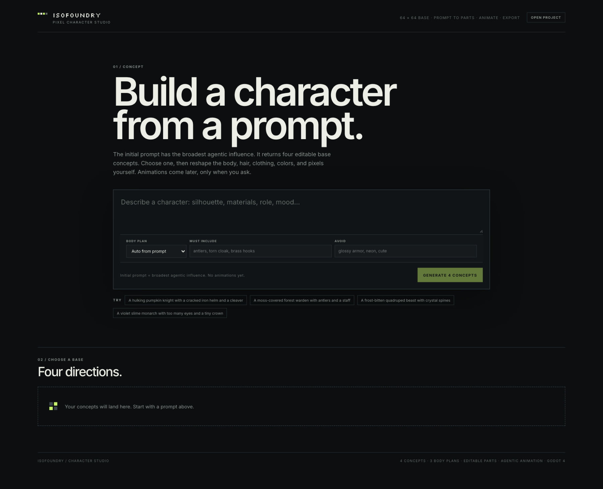
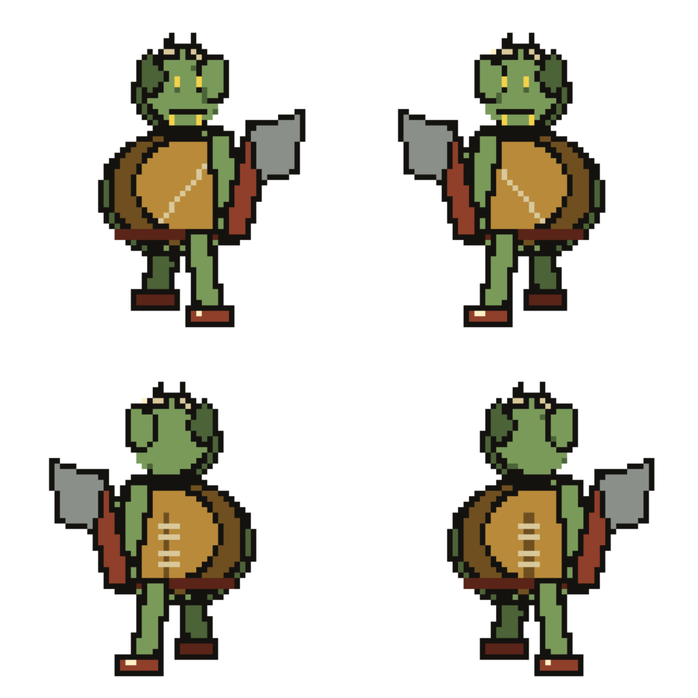
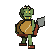

# Isofoundry Character Studio

An **agent-assisted pixel character builder** — a web application, not a game. It turns a structured character prompt into four editable base concepts, each rendered in four true isometric diagonal views. It then gives you a layered part editor, a multi-color palette, pixel painting, PNG import/slicing, and agentic first-pass animation with a hand-editable timeline.



## What it does

- **Structured prompt → 4 concepts.** The initial prompt has the broadest agentic influence.
- **Four isometric views per concept:** Front-Right, Front-Left, Back-Left, Back-Right.
- **12-second turntable:** each concept card rotates through the four views at 3 seconds per view.
- **Humanoid, quadruped, and blob** body plans.
- **Choose one base**, then edit it manually in every view.
- **Layered part rig** with pivots, z-order, visibility, and transforms.
- **Detach / explode / assemble:** separate parts for editing, then snap them back.
- **Body, hair, clothing, and feature controls**, each with field-level color shortcuts.
- **Multi-color indexed palette:** 12 named roles plus up to 32 custom colors.
- **Pixel editor:** select, pencil, eraser, fill, eyedropper, brush sizes, zoom, grid.
- **Resizable sprite canvas:** 16×16 to 256×256, default 64×64, scale-art or crop/extend.
- **Full-character PNG import for one view:** locked reference layer, vision body-plan suggestion, manual rectangle/lasso slicing into parts.
- **Per-view editing:** paint, recolor, detach, explode, and transform parts independently in each direction.
- **Agentic animation first pass:** idle, run, jump, attack, death, or custom prompts, applied to all four views.
- **Timeline editing:** frames, FPS, loop, onion skin, per-frame part transforms, and per-view pixel painting.
- **All export paths:** 12-second turntable GIF, four-view sheet, per-view PNGs, per-view/directional GIFs, directional PNG frame sequence, directional sprite sheet + JSON, Godot 4 directional clips, and project JSON.


## Run

```bash
cd ~/Projects/isofoundry
npm install
npm run dev
```

The dev command starts both the local agent API and the Vite app, waits for the API, then opens the browser at <http://localhost:4173>.

Requirements:

- Node.js 20+
- OpenCode running locally with the configured text/vision model

Optional environment overrides:

```bash
OPENCODE_MODEL=deepseek-v4.1-flash
OPENCODE_PROVIDER=opencode-go
API_PORT=4174
```

If the agent is unavailable, the builder falls back to deterministic concepts, body plans, and animation presets.

Production:

```bash
npm run build
npm start
# production app + API at http://localhost:4173
```

## Workflow

1. Enter a structured concept: character description, body plan, must-haves, and anti-goals.
2. Generate four concepts.
3. Choose one. No animation is created yet.
4. Switch between **FR / FL / BL / BR** view tabs. Each view is independently editable.
5. Edit Body, Hair/Coat, Clothing, features, and colors. The spec and palette are shared across views.
6. Select a part and draw directly on the active view.
7. Detach or explode parts, edit, then assemble.
8. Optionally import a full-character PNG as a locked reference for one view and slice it into parts.
9. Add an animation when ready. The agent blocks out transforms and timing; all four views play it.
10. Edit frames in the timeline and paint per-view overrides.
11. Export the turntable, view set, and directional animation clips.


## Four isometric views

Each character is stored as four separate 2D isometric diagonal sprites, not one flat bitmap rotated in screen space.

| View | Compass | Sees |
| --- | --- | --- |
| Front-Right | SE | face, near right side, forward weapon |
| Front-Left | SW | face, near left side, forward weapon |
| Back-Left | NW | back of head, far side, rear gear |
| Back-Right | NE | back of head, far side, rear gear |

The turntable order is:

**Front-Right → Front-Left → Back-Left → Back-Right**

- 3 seconds per view
- 12-second loop
- Step rotation, not interpolation
- The concept cards rotate live while you compare bases
- `turntable.gif` exports the same 12-second loop with transparency

Each view has its own part layers, pixel data, pivots, and base transforms. The body plan, build, hair style, clothing style, features, and palette are shared. Painting edits only the active view. Palette changes recolor every view. Body, hair, and clothing changes rebuild all four views while preserving per-view manual edits where possible. Part IDs stay consistent so animation tracks target the same rig in every direction.

Existing single-view projects migrate by treating their old pixels as **Front-Right** and generating the other three views from the spec.





## Body and appearance

**Body**
- Body plan selector.
- Body-style presets for humanoids: Goblin, Brute, Imp, Skeleton.
- Height, width, head, torso, arms, legs sliders.
- Skin/skin-shadow color pickers.

**Hair / Coat**
- Humanoid hair styles: bald, short, long, mohawk, topknot, hooded.
- Hair color shortcuts.
- Quadruped/blob support uses their body/coat parts.

**Clothing**
- None, tunic, leather, armor, robe, rags, cloak.
- Cloth, cloth-shadow, trim, and metal color shortcuts.

**Palette**
- Named roles for skin, shadow, primary, secondary, accent, metal, outline, eye, and highlight.
- Up to 32 additional indexed colors.
- Stable slots: removing a used color is blocked until its pixels are recolored.
- Click any swatch to draw with it.

## Sprite size


- Default 64×64.
- Custom canvas from 16×16 to 256×256.
- **Scale art** scales the full part stack and animation transforms.
- **Crop/extend** keeps pixel scale and changes the working area.

## PNG imports

The PNG import accepts a **single full-character image for one view**:

1. Choose the reference view. The default is the active view, normally **Front-Right**.
2. Fit the PNG to the canvas and lock it as that view's reference layer.
3. The vision reader suggests a body plan.
4. Use the rectangle or lasso slice tool to cut regions into editable parts.
5. Slices are quantized to the indexed palette and added to the current view.
6. The other three views remain generated from the character spec.
7. Hide/show the reference layer while editing.
8. Imported parts can be detached, transformed, painted, and animated like generated parts.

Manual slicing remains available without the agent.

## Agentic animation

Animations are never created automatically. The user presses **Animate this character** and chooses a preset or writes a direction prompt.

The agent receives the character spec, part rig, body plan, current pose, and animation prompt. It returns one validated motion track. That track is applied to all four isometric views, while pixel overrides remain per view. The timeline and canvas both follow the active view tab. Each track contains:

- Clip name
- FPS and loop behavior
- Frame timing
- Root and per-part transforms
- No generated pixels

The first pass is a motion sketch. The user can:

- Play the clip.
- Edit FPS, loop, frame duration, and onion skin.
- Add, duplicate, and delete frames.
- Edit part transforms per frame.
- Paint per-frame pixel overrides on the selected part.
- Clear frame overrides.
- Regenerate a first pass with a new prompt.

Presets: **Idle, Run, Jump, Attack, Death, Custom**. The prompt can specify timing, weight, anticipation, and pose details.

Exports produce direction-specific clips such as `run_front_right`, `run_front_left`, `run_back_left`, and `run_back_right`.

## Exports


- **12-second turntable GIF:** FR → FL → BL → BR, 3 seconds per view, transparent and looping.
- **Four-view sheet:** 2×2 transparent PNG at 4× scale.
- **All view PNGs:** one transparent PNG per direction in a zip.
- **Active view PNG:** the current view at 4×.
- **Animated GIF · active view:** transparent frames with loop or one-shot timing.
- **Animated GIFs · all views:** four directional GIFs in a zip.
- **Directional frame sequence:** PNG per frame, grouped into four view folders.
- **Directional sprite sheet + JSON:** four view rows with frame regions and view metadata.
- **Godot 4 bundle:** `SpriteFrames` `.tres`, atlas PNG, and metadata with `idle_front_right`-style clips.
- **Project JSON:** re-importable four-view character, palette, parts, references, and animation data.

The Godot bundle was validated in Godot **4.7.1** with four directional run clips, six frames each.

## Agent behavior

The agent is deliberately limited:

- JSON-only structured output.
- No image generation.
- No code execution or tool access.
- No automatic calls.
- Initial concept generation has the widest creative range.
- Refinement sends a four-view contact sheet back and is constrained to preserve the current character and view consistency unless asked otherwise.
- Animation generation produces motion tracks, not pixel frames.
- Deterministic fallbacks keep the editor usable when the agent fails.

## Project data

- IndexedDB autosaves the current character and history.
- Project JSON allows full round-trip import/export.
- Versions and undo/redo are kept in the editor.
- The application starts with no dummy character or prompt.

## Architecture

```text
server/
  index.ts          Local API server + production static host
  agent.ts          OpenCode character, refine, animation, and vision calls
src/
  lib/
    generator.ts    Deterministic concepts, palettes, presets, animations
    render.ts       Indexed-pixel rasterizer, four-view isometric part builders, compositor
    schemas.ts      Zod schemas and normalization
    export.ts       Turntable GIF, view sheet, directional GIF/PNG/sheet, Godot export
    slice.ts        PNG reference slicing and palette quantization
    storage.ts      IndexedDB project storage
  store/
    studio.ts       Editor state, undo/redo, frames, transforms, autosave
  components/
    StartScreen, Studio, PixelCanvas, Panels, Timeline, modals
```

The art is rendered from a controlled part grammar. Agent output is structured direction only; there is no raw image generation.

## POC limits

- The agent is local to this machine for now. A hosted provider adapter is not yet wired.
- PNG import uses vision for body-plan classification and manual slicing for parts; automatic full segmentation is deferred.
- Animation first pass edits part transforms and manual pixel overrides; advanced rig constraints are not yet exposed.
- The four views are generated from a shared 3/4 view grammar, not a full 3D/voxel source model. A volumetric source model can replace the renderer later without changing the editor/export data model.
- Godot is the only engine export in this POC.

## Branches

- `main` — the four-view character studio.
- `feature/four-isometric-views` — the four-view isometric upgrade.
- `poc/character-builder` — the original single-view character studio POC.
- `archive/style-lab-v1` — the previous broad isometric style lab.

## Verification

```bash
npm test
npm run build
```

The current suite covers character generation, all three body plans, hair parts, animation presets, palette custom slots, animation schema normalization, four distinct isometric views, back-view face suppression, 3-second/12-second turntable timing, and legacy single-view migration.
