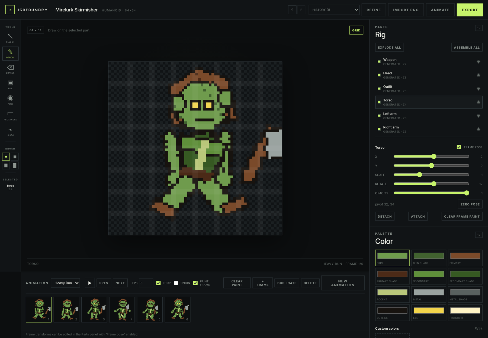
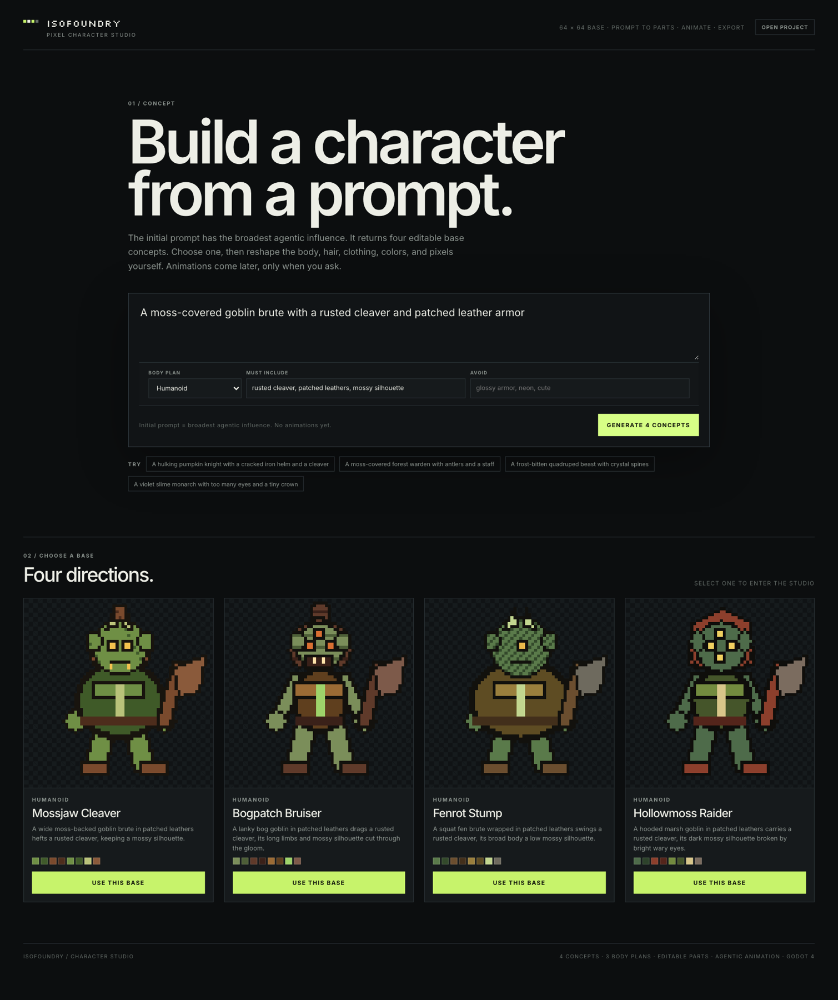
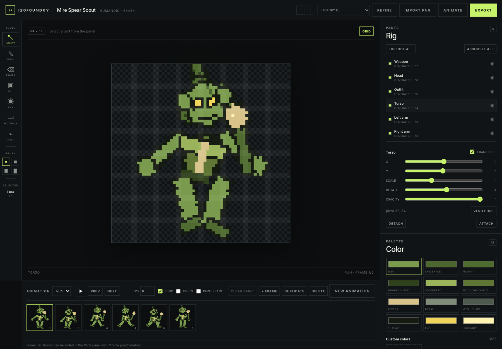
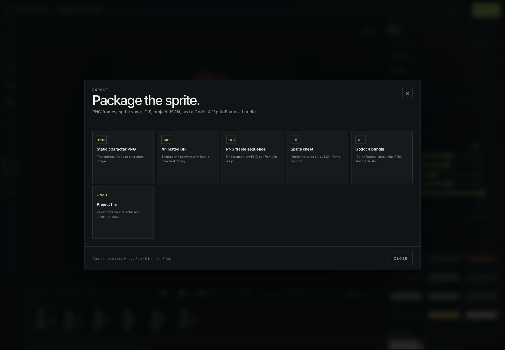

# Isofoundry Character Studio

An **agent-assisted pixel character builder** — a web application, not a game. It turns a structured character prompt into four editable base concepts, then gives you a layered part editor, a multi-color palette, pixel painting, PNG import/slicing, and agentic first-pass animation with a hand-editable timeline.


## What it does

- **Structured prompt → 4 concepts.** The initial prompt has the broadest agentic influence.
- **Humanoid, quadruped, and blob** body plans.
- **Choose one base**, then edit it manually.
- **Layered part rig** with pivots, z-order, visibility, and transforms.
- **Detach / explode / assemble:** separate parts for editing, then snap them back.
- **Body, hair, clothing, and feature controls**, each with field-level color shortcuts.
- **Multi-color indexed palette:** 12 named roles plus up to 32 custom colors.
- **Pixel editor:** select, pencil, eraser, fill, eyedropper, brush sizes, zoom, grid.
- **Resizable sprite canvas:** 16×16 to 256×256, default 64×64, scale-art or crop/extend.
- **Full-character PNG import:** locked reference layer, vision body-plan suggestion, manual rectangle/lasso slicing into parts.
- **Agentic animation first pass:** idle, run, jump, attack, death, or custom prompts.
- **Timeline editing:** frames, FPS, loop, onion skin, per-frame part transforms, and per-frame pixel painting.
- **All export paths:** static PNG, animated GIF, PNG frame sequence, sprite sheet + JSON, Godot 4 bundle, and project JSON.



## Run

```bash
cd ~/Projects/isofoundry
npm install
npm run dev
```

The dev command starts both the local agent API and the Vite app, waits for the API, then opens the browser at <http://localhost:4173>.

Requirements:

- Node.js 20+
- OpenCode running locally with the configured text/vision model

Optional environment overrides:

```bash
OPENCODE_MODEL=deepseek-v4.1-flash
OPENCODE_PROVIDER=opencode-go
API_PORT=4174
```

If the agent is unavailable, the builder falls back to deterministic concepts, body plans, and animation presets.

Production:

```bash
npm run build
npm start
# production app + API at http://localhost:4173
```

## Workflow

1. Enter a structured concept: character description, body plan, must-haves, and anti-goals.
2. Generate four concepts.
3. Choose one. No animation is created yet.
4. Edit Body, Hair/Coat, Clothing, features, and colors.
5. Select a part and draw directly on the canvas.
6. Detach or explode parts, edit, then assemble.
7. Optionally import a full-character PNG as a locked reference and slice it into parts.
8. Add an animation when ready. The agent blocks out transforms and timing.
9. Edit frames in the timeline and paint per-frame overrides.
10. Export.



## Body and appearance

**Body**
- Body plan selector.
- Body-style presets for humanoids: Goblin, Brute, Imp, Skeleton.
- Height, width, head, torso, arms, legs sliders.
- Skin/skin-shadow color pickers.

**Hair / Coat**
- Humanoid hair styles: bald, short, long, mohawk, topknot, hooded.
- Hair color shortcuts.
- Quadruped/blob support uses their body/coat parts.

**Clothing**
- None, tunic, leather, armor, robe, rags, cloak.
- Cloth, cloth-shadow, trim, and metal color shortcuts.

**Palette**
- Named roles for skin, shadow, primary, secondary, accent, metal, outline, eye, and highlight.
- Up to 32 additional indexed colors.
- Stable slots: removing a used color is blocked until its pixels are recolored.
- Click any swatch to draw with it.

## Sprite size



- Default 64×64.
- Custom canvas from 16×16 to 256×256.
- **Scale art** scales the full part stack and animation transforms.
- **Crop/extend** keeps pixel scale and changes the working area.

## PNG imports

The PNG import accepts a **single full-character image**:

1. Fit it to the canvas and lock it as a reference.
2. The vision reader suggests a body plan.
3. Use the rectangle or lasso slice tool to cut regions into editable parts.
4. Slices are quantized to the indexed palette.
5. Hide/show the reference layer while editing.
6. Imported parts can be detached, transformed, painted, and animated like generated parts.

Manual slicing remains available without the agent.

## Agentic animation

Animations are never created automatically. The user presses **Animate this character** and chooses a preset or writes a direction prompt.

The agent receives the character spec, part rig, body plan, current pose, and animation prompt. It returns a validated frame plan:

- Clip name
- FPS and loop behavior
- Frame timing
- Root and per-part transforms
- No generated pixels

The first pass is a motion sketch. The user can:

- Play the clip.
- Edit FPS, loop, frame duration, and onion skin.
- Add, duplicate, and delete frames.
- Edit part transforms per frame.
- Paint per-frame pixel overrides on the selected part.
- Clear frame overrides.
- Regenerate a first pass with a new prompt.

Presets: **Idle, Run, Jump, Attack, Death, Custom**. The prompt can specify timing, weight, anticipation, and pose details.

## Exports



- **Static character PNG** at 4×.
- **Animated GIF** with transparent frames and loop/one-shot timing.
- **PNG frame sequence** ZIP.
- **Sprite sheet + JSON** with frame regions.
- **Godot 4 bundle:** `SpriteFrames` `.tres`, atlas PNG, and metadata.
- **Project JSON:** re-importable character, palette, parts, references, and animation data.

The Godot bundle was validated in Godot **4.7.1** with a multi-frame animation.

## Agent behavior

The agent is deliberately limited:

- JSON-only structured output.
- No image generation.
- No code execution or tool access.
- No automatic calls.
- Initial concept generation has the widest creative range.
- Refinement sends the current rendered art back and is constrained to preserve the current character unless asked otherwise.
- Animation generation produces motion tracks, not pixel frames.
- Deterministic fallbacks keep the editor usable when the agent fails.

## Project data

- IndexedDB autosaves the current character and history.
- Project JSON allows full round-trip import/export.
- Versions and undo/redo are kept in the editor.
- The application starts with no dummy character or prompt.

## Architecture

```text
server/
  index.ts          Local API server + production static host
  agent.ts          OpenCode character, refine, animation, and vision calls
src/
  lib/
    generator.ts    Deterministic concepts, palettes, presets, animations
    render.ts       Indexed-pixel rasterizer, part compositor, frame rendering
    schemas.ts      Zod schemas and normalization
    export.ts       PNG, GIF, frame ZIP, sprite sheet, Godot export
    slice.ts        PNG reference slicing and palette quantization
    storage.ts      IndexedDB project storage
  store/
    studio.ts       Editor state, undo/redo, frames, transforms, autosave
  components/
    StartScreen, Studio, PixelCanvas, Panels, Timeline, modals
```

The art is rendered from a controlled part grammar. Agent output is structured direction only; there is no raw image generation.

## POC limits

- The agent is local to this machine for now. A hosted provider adapter is not yet wired.
- PNG import uses vision for body-plan classification and manual slicing for parts; automatic full segmentation is deferred.
- Animation first pass edits part transforms and manual pixel overrides; advanced rig constraints are not yet exposed.
- Single editable character view for now; multi-view/isometric promotion is a later feature.
- Godot is the only engine export in this POC.

## Branches

- `poc/character-builder` — this character studio POC.
- `archive/style-lab-v1` — the previous broad isometric style lab.
- `main` — the archived style lab until the POC is approved and merged.

## Verification

```bash
npm test
npm run build
```

The current suite covers character generation, all three body plans, hair parts, animation presets, palette custom slots, and animation schema normalization.
