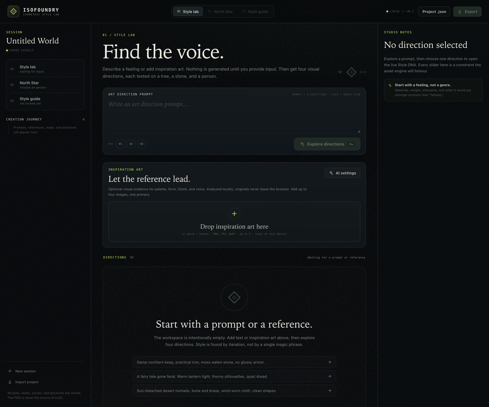
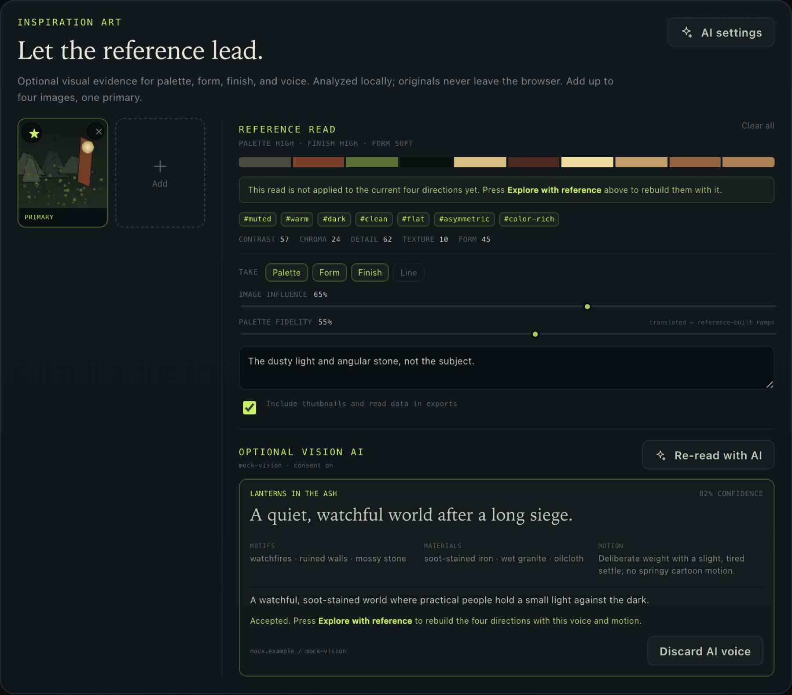

# Isofoundry

A local-first, prompt-driven **isometric pixel-art style lab**. It finds a visual voice before it scales into an asset factory: you prompt, add inspiration art, compare directions on the same calibration probes, lock the traits that matter, develop one **North Star** asset, and turn that asset into a measurable Style DNA.

This is **Milestone 1 — style and voice**. It is deliberately focused on the hardest part to fake: a consistent look that can be carried into characters, enemies, props, buildings, and landscape.



## What works

- **Prompt → four directions.** Prompts are parsed into structured changes: palette intent, shape language, detail budget, motion feel, voice axes, keywords, and anti-goals.
- **Inspiration art.** Drop, paste, or browse up to four references. One primary leads; support references add mood and material support. The local reader extracts palette, contrast, chroma, warmth, edge density, detail, texture, and soft form cues. Originals never leave the browser.
- **Reference-led modes.** Directions can be palette-led, form-led, finish-led, or a prompt-led counterpoint. Each shows an Inspiration match score.
- **Palette fidelity.** Blend between Isofoundry's translated material ramps and ramps rebuilt from the reference palette, while keeping the five-stop material structure.
- **Optional vision AI.** An OpenAI-compatible reader adds theme, motifs, mood, narrative voice, and motion suggestions. It is explicit, consent-gated, and never generates pixels.
- **Calibration probes.** Every direction is rendered on the same tree, stone, and person. Comparison is apples-to-apples.
- **Live Style DNA.** Palette, form, finish, and motion sliders update the render immediately. Prompt refits show exactly what changed.
- **Trait locks.** Lock palette, form, detail, line, or motion so later prompts cannot move them.
- **North Star development.** Choose any subject, browse four variants, and step through sketch → refine → final. A four-frame motion study defines the motion voice.
- **Style Signature.** Locking the anchor extracts palette, value structure, edge density, detail entropy, silhouette complexity, outline weight, fill, and symmetry.
- **Style Fit Lab.** A contrasting asset is scored on-style against the anchor, and a deliberately drifted version is scored beside it. The score is explainable and is not a substitute for taste.


- **Creation journey.** Prompts, references, reads, AI suggestions, selections, locks, refinements, anchor decisions, tests, and exports are stored locally. The project can be exported and imported.
- **Asset archetypes.** Wanderer, enemy brute, tree, stone, shrine, crystal cluster, crate, and terrain tile. Each is generated from the same Style DNA.
- **Exports.** Style pack ZIP, style guide PNG, anchor PNG at 4×, motion sheet, style guide JSON, palette `.gpl`, project JSON, and a Godot 4 `SpriteFrames` resource.

## Run it

```bash
cd ~/Projects/isofoundry
npm install
npm run dev
```

The app opens in your default browser at <http://localhost:4173>. If port 4173 is already in use, stop the old server first:

```bash
lsof -ti tcp:4173 | xargs kill
```

The app saves the working project to `localStorage`. Use **Project .json** to archive it, **Import project** to restore it, and **New session** to start blank. **Reset demo** restores the starter prompt.

## The workflow

1. **Describe a feeling, not a genre.** Try a material, a mood, and an anti-goal:
   > Moss-eaten stone, practical iron, wind-worn cloth. Grounded and tactile, with a quiet strangeness. No glossy armor.
2. **Add inspiration art (optional).** Drop up to four references. Mark one primary. Add a note about what draws you to it. Set the image influence and palette fidelity.
3. **Explore four directions.** Each card shows the same tree, stone, and person. Reference-led cards show `REF` scores and their mode.
4. **Select a direction.** The live Style DNA opens on the right.
5. **Refine with prompts.** Say “colder light, rounder forms, heavier motion, no neon.” Or move the sliders directly.
6. **Lock traits.** Hold the palette or form while you explore other qualities.
7. **Optional AI read.** Configure an OpenAI-compatible endpoint and press **Read with AI**. Accept the narrative/motion read if it fits.
8. **Develop the North Star.** Pick a subject, choose a variant, review sketch/refine/final, then lock it.
9. **Read the guide.** Check the palette, voice, signature, influence record, and motion study. Run the fit lab against a contrasting asset.
10. **Export.** The ZIP includes the anchor, frames, guide board, palette, journey, references, and Godot resource.


## Inspiration art

The inspiration panel turns reference art into structured direction, not a decorative moodboard.

- **Primary + support references.** Up to four images. The primary leads; support references contribute mood, materials, and palette support.
- **Local read.** Dominant palette, accent and foliage hue, chroma, warmth, value contrast, edge density, detail entropy, texture, flatness, and soft form cues. A dominant presentation border is excluded from the read.
- **Feature toggles.** Take palette, form, finish, and/or line from the reference.
- **Image influence.** Blend the reference with the prompt at 0–100%.
- **Palette fidelity.** At 0, the reference informs the translated Isofoundry ramps. At 1, the material ramps are rebuilt from the reference palette while preserving the five-stop material structure.
- **Notes.** “What draws you here?” feeds the AI read and the style archive.
- **Not inferred.** Motion and narrative voice are not claimed from a still image. They come from the prompt, notes, or an explicit vision read.



### Optional vision AI

The reader works with any **OpenAI-compatible** `/chat/completions` endpoint: OpenAI, OpenRouter, LM Studio, Ollama, and similar.

- Add the base URL, model, and key in **AI settings**.
- The key lives in `sessionStorage` by default. “Remember on this device” is an explicit opt-in and is never written to project exports.
- Nothing is sent until you press **Read with AI** and confirm the consent checkbox.
- Request: downscaled reference thumbnails, the local measurements, the prompt, and the notes.
- Response: theme, motifs, materials, mood, shape language, narrative voice, motion suggestion, voice axes, keywords, anti-goals, manifesto, confidence.
- The AI suggestions are shown separately and only applied after **Use AI voice + motion**.
- Palette and finish remain grounded in the local read. If the provider is unavailable or blocked by CORS, the reference flow still works locally.

## Export pack

```text
anchor/<name>@4x.png
anchor/<name>@1x.png
motion/idle_0..3.png
style-guide.png
style-guide.json
palette.gpl
project.json
inspiration.json
vision-read.json          # when a vision read exists
references/01-<name>.webp  # or .png; when references are included
godot/motion_frames.tres
godot/README.txt
README.md
```

The Godot resource was verified against **Godot 4.7.1**: copy `motion/` and `godot/motion_frames.tres` into a project and load the `SpriteFrames` resource.

## Verification

```bash
npm test       # renderer, signatures, prompts, inspiration analysis, vision parsing, Godot resource
npm run build  # typecheck + production build
```

The current suite has 19 tests. The exported Godot resource was loaded in a headless 4.7.1 project and confirmed to expose `idle` with four frames at 6 fps.

## Architecture

```text
src/
  lib/
    color.ts        OKLCH ramps, hue blending, alpha compositing
    palette.ts      material palette derivation + reference ramp blending
    inspiration.ts  local image analysis, combined reads, reference matching
    vision.ts       OpenAI-compatible vision reader + key handling
    dna.ts          Style DNA, voice axes, mutation and drift
    prompt.ts       prompt grammar, anti-goals, direction variation
    raster.ts       deterministic pixel buffer + hard-edged raster ops
    draw.ts         isometric primitives, shading, texture, outline
    assets/         tree, stone, character/enemy, building, crystal, crate
    render.ts       archetype dispatch and finalization
    signature.ts    Style Signature extraction + styleFit comparison
    export.ts       board, sheets, ZIP, palette, Godot SpriteFrames
  state/
    useProject.ts   project actions, journey, autosave
  components/
    InspirationPanel, VisionSettings, Lab, Inspector, Develop, Guide, JourneyRail, canvases
```

The renderer is deterministic. A DNA record and a seed reproduce the same pixels; the journey is the source of truth, not the flattened PNG. The current renderer is a 2.5D isometric sprite engine with a pixel-art finishing pass. The planned next renderer step is a voxel-backed volume stage for guaranteed multi-view consistency.

## Design rules encoded in the product

- **Color:** OKLCH material ramps, hue-shifted shadows, controlled chroma, contrast checks.
- **Form:** roundness, chunkiness, spikiness, asymmetry, head scale, height.
- **Pixel craft:** selective outlines, cluster texture, dithering, no anti-aliasing.
- **Composition:** light from top-left, 2:1 isometric ground plane, readable silhouette at 1×, and a φ-bias control that weights character head/hip proportions and building roof/tier proportions. Toggle the φ overlay in the artboard to inspect the composition.
- **Motion:** weight, bounce, sway; four-frame motion studies.
- **Voice:** grounded, ornate, brutal, springy, vivid, gritty, plus keywords and anti-goals.
- **Heuristic:** hard style constraints plus anchor similarity. Scores rank candidates and flag drift; they never replace approval.

## Next milestones

- **M2 — Production pipeline:** primary-view assets at volume, terrain autotiles, modular buildings, validation gates, generic atlas export.
- **M3 — Views + animation:** four/eight-view promotion from a shared volume rig; idle, walk, run, attack, cast, hurt, and death clips; event markers, pivots, hitboxes.
- **M4 — World kit:** cliffs, water, roads, props, damage states, occlusion layers, scene preview, fuller Godot integration.
- **M5 — Studio scale:** local project folders, batch CLI, local AI relay for CORS/key isolation, native provider presets, desktop packaging.

## Notes

- No image-generation model is required. The prompt and local reference layers are deterministic and local.
- Vision AI is optional and only interprets. It never generates sprites or writes pixels.
- References are analyzed as measurements, not traced. Use reference art you have the right to use.
- The goal is not to remove the artist. It is to make style decisions explicit, repeatable, and re-openable.
